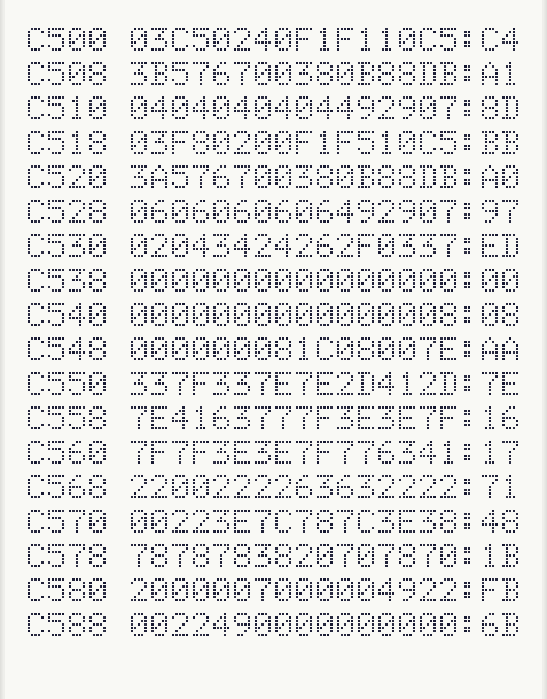
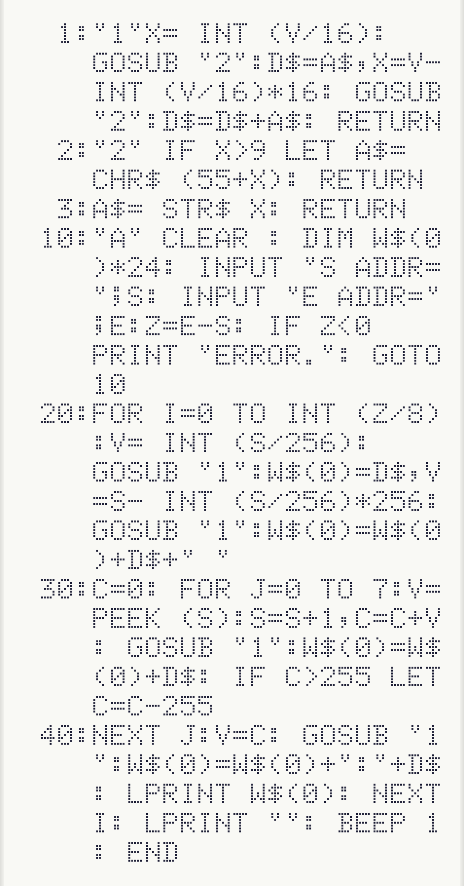

# pc1245-DumpListPrinter

 

## 概要

マシン後ダンプリストをプリンターに出力します。
出力は、PiO等の工学社の雑誌に掲載されていたフォーマットに合わせています。

 

## 使い方

1. マシン後プログラムを本体にロードします。
2. ダンプリストプリンターのプログラムをロードします。
3. [DEF][A]で開始します。
4. 出力開始アドレス、終了アドレスを入力すると、プリンターに出力されます。
5. 出力が完了するとビープ音が鳴って知らせます。

出力例： 

 

 

## 注意事項

- ダンプは1行8バイトで出力しますが、終了アドレスが8の倍数でない場合は途中で切れますので、きれいに出力するには終了アドレスは8の倍数を指定するようにしてください。
- 少しでも高速化するために1〜3行目にサブルーチンを配置しています。PC-1251 Emulatorで本プログラムをロードする場合は、[Shift]+[Enter]で読み込み、自動実行しないようにしてください。

 

## プログラムリスト

 

※実機でロードできる環境のある方は、CLOADできる音声データを /wav/DumpListPrinter.wav で置いています。 

 

## 作者

Hitoshi Iwai (aburi6800)

 

## 更新履歴

2026/10/25 ver1.00
- 初期リリース

 

## ライセンス

MIT Licence

 

## 謝辞

- [PC-1251 Emulator](https://github.com/woriguchi/pc1251-emulator/tree/main)
